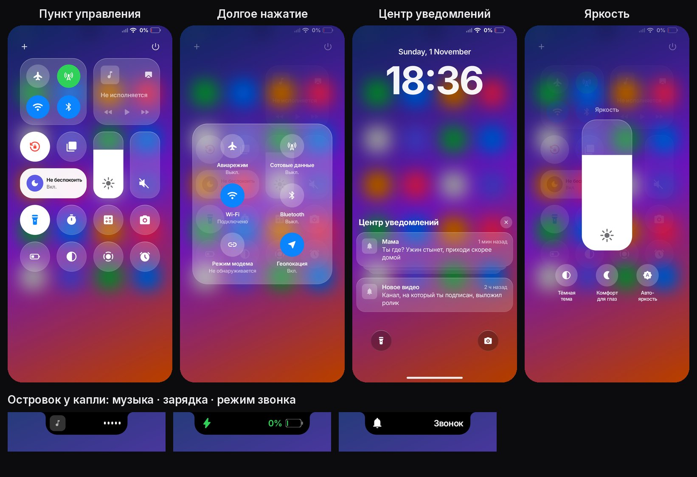

# Шторка

Пункт управления, Центр уведомлений и «островок» у камеры в стиле iPhone —
для Android, под Samsung Galaxy A26 5G (камера-капля по центру).

**Готовый APK:** [`release/shtorka-1.0.apk`](../release/shtorka-1.0.apk) · 0.8 МБ · Android 8.0+



---

## Как пользоваться

| Жест | Что происходит |
|---|---|
| Свайп вниз от верхнего края **справа от капли** | Пункт управления |
| Свайп вниз от верхнего края **слева от капли** | Центр уведомлений |
| Свайп вниз **двумя пальцами** | Обычная шторка Samsung |
| Долгое нажатие на блок связи, яркость, громкость, плеер | Блок раскрывается на весь экран |
| Свайп вверх, тап мимо кнопок, «Назад» | Закрыть |
| Тап по островку с музыкой | Плеер прямо в островке |

## Установка

1. Скачай `shtorka-1.0.apk` и установи. Play Защита может предупредить, что
   приложение не из магазина, — «Всё равно установить».
2. Открой «Шторку» и пройди раздел **Доступы** сверху вниз:
   - **Специальные возможности → Шторка → Вкл.** Если переключатель серый
     («Ограниченная настройка»): Настройки → Приложения → Шторка → ⋮ (вверху
     справа) → «Разрешить ограниченные настройки», потом включи ещё раз.
   - **Доступ к уведомлениям** — для Центра уведомлений, музыки и «Не беспокоить».
   - **Изменение настроек** — для яркости, автояркости и поворота.
   - **Работа без ограничений** — чтобы Samsung не усыплял шторку.
3. Готово. После перезагрузки телефона ничего включать не нужно.

### Автозапуск

Включённую службу специальных возможностей Android запускает сам при каждом
включении телефона. Если какой-нибудь «оптимизатор» её выключит, шторка умеет
включить себя обратно — для этого один раз нужна команда с компьютера:

```bash
adb shell pm grant com.tihon.shtorka android.permission.WRITE_SECURE_SETTINGS
```

Без неё после такого выключения придёт уведомление «Шторка выключена».

---

## Что внутри

### Пункт управления (раскладка iOS 18)

```
[ связь 2×2 ][ музыка 2×2 ]
[🔒][⧉]  [☀][🔊]
[ фокус 2×1 ][  ][  ]
[🔦][⏱][🧮][📷]
[🔋][◐][⏺][⏰]   ← нижний ряд, выключается в настройках
```

| Кнопка | Как работает |
|---|---|
| Wi-Fi, Bluetooth | переключаются напрямую |
| Авиарежим, мобильные данные, режим модема, геолокация | нажимается плитка в спрятанной панели Samsung (см. ниже) |
| Блокировка поворота, яркость, автояркость | напрямую через системные настройки |
| Громкость | напрямую, без системного ползунка |
| Не беспокоить | через доступ к уведомлениям |
| Фонарик | напрямую; долгое нажатие — регулировка яркости (Android 13+, если камера умеет) |
| Повтор экрана, запись экрана | открывают Smart View / запись Samsung |
| Энергосбережение, тёмная тема, комфорт для глаз | плитка Samsung |
| Таймер, калькулятор, камера, будильник | открывают приложения |
| `+` / `⏻` | настройки шторки / меню питания |

Ползунки ведут себя как в iOS: тянутся относительно пальца, а не прыгают под
него, за краем резиново растягиваются, значок внизу темнеет ровно там, где его
накрывает заливка.

### Центр уведомлений

Как экран блокировки iPhone: дата и большие часы, «Исполняется», уведомления
стопками по приложениям. Тап по стопке разворачивает её, тап по уведомлению
открывает приложение, свайп в сторону смахивает. Внизу — фонарик и камера.
Весь лист опускается за пальцем, как занавес.

### Островок у капли

Чёрная форма вокруг капли камеры, которая вогнутыми скруглениями переходит в
верхний край экрана — выглядит продолжением выреза. Показывает:

- **музыку** — обложка и волна в цвет обложки; тап раскрывает плеер;
- **зарядку** — процент при подключении кабеля;
- **режим звонка** — звонок, вибрация или без звука.

Без событий островок прячется обратно в каплю.

---

## Как устроено

```
src/main/java/com/tihon/shtorka/
├── service/   служба спец. возможностей, слушатель уведомлений, автозапуск
├── system/    переключатели, фонарик, музыка, уведомления, размытый фон, плитки
├── ui/        окно шторки, жесты, общие виды
│   ├── cc/    Пункт управления: модули и их раскрытие
│   ├── nc/    Центр уведомлений
│   └── island/ островок
└── MainActivity.kt   настройки в стиле iOS
```

**Почему служба специальных возможностей.** Только окно
`TYPE_ACCESSIBILITY_OVERLAY` лежит выше строки состояния и шторки Samsung —
иначе свайп сверху до шторки не дойдёт. Плюс служба умеет делать снимок экрана
для размытого фона и нажимать плитки быстрых настроек. Включённую службу Android
сам поднимает после перезагрузки — отсюда автозапуск.

**Размытый фон.** В момент касания делается снимок экрана, уменьшается до
160 px по ширине, размывается трёхпроходным блочным фильтром и растягивается
обратно с билинейной фильтрацией — мягкое «стекло» почти даром. Пока снимка нет
(или экран защищён, как в банке), фон просто затемняется.

**Плитки Samsung.** Авиарежим, мобильные данные, геолокацию и т.п. сторонним
приложениям переключать нельзя. Шторка открывает системную панель быстрых
настроек *под собой* (её не видно за размытым фоном), находит плитку по подписи
на русском или английском, нажимает, подтверждает диалог Samsung, если он
появился, и закрывает панель. Если плитки нет — открывается нужный раздел
настроек.

**targetSdk 28.** Осознанно: с 29 Android запрещает приложениям включать Wi-Fi,
с 33 — Bluetooth. Для старого targetSdk оба вызова работают и на Android 15.

**Анимации.** Всё на пружинах (`SpringAnimation`): открытие подхватывает
скорость пальца и чуть «перелетает», модули появляются по рядам сверху вниз,
раскрытый модуль вырастает из маленького, островок течёт из капли.
Каждый кадр меняет только свойства RenderNode (сдвиг, масштаб, прозрачность),
без перекладки — плавно и на 120 Гц.

**Шрифт** — Inter (SIL OFL 1.1, [`res/font`](src/main/res/font), лицензия в
[`OFL.txt`](OFL.txt)). **Значки** — Material Symbols Rounded (Apache 2.0).

## Сборка

```bash
./gradlew :shtorka:assembleRelease
```

Без ключа `keystore/shtorka.jks` релиз подписывается отладочной подписью — тогда
новая версия, собранная на другой машине, не встанет поверх старой: удали и
поставь заново.

Посмотреть экраны без телефона (Robolectric рисует настоящие View в PNG):

```bash
./gradlew :shtorka:testDebugUnitTest    # shtorka/build/shots/*.png
```
